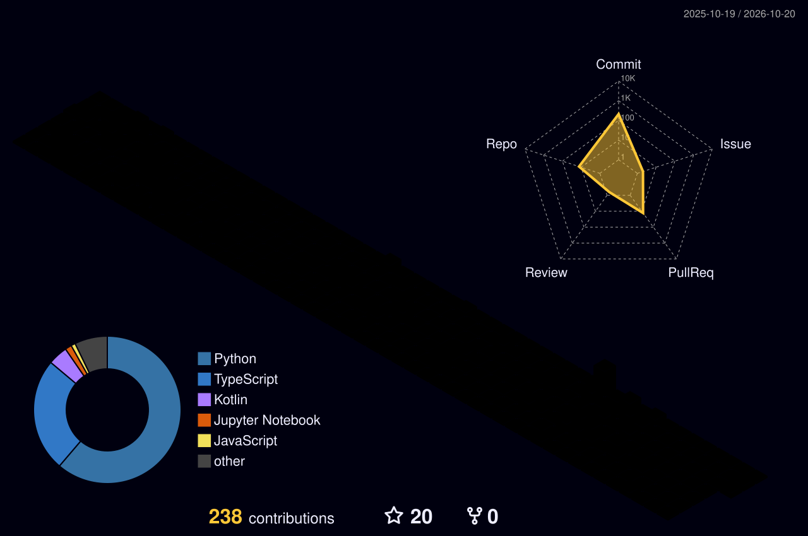

<div align="center">


<a href="https://github.com/khoavd18">
  
</a>

**Building models. Finding patterns. Connecting data.**

<p>
  
  
  
</p>

<p>
  <a href="https://www.linkedin.com/in/khoadang18/"></a>
  <a href="https://github.com/khoavd18"></a>
  <a href="https://www.facebook.com/khoa.ang.18"></a>
  <a href="https://discord.gg/apolo11"></a>
</p>

[About Me](#-about-me) · [Toolkit](#-languages--tools) · [Projects](#-selected-projects) · [GitHub Dashboard](#-github-dashboard)

</div>

## 🧑‍💻 About Me

Hi, I'm **Khoa**. I work across **AI engineering, data science, and data engineering**, with a focus on turning data into useful applications. I enjoy preparing datasets, building models, investigating results, and connecting the pieces into a working system.

<table>
  <tr>
    <td width="33%" valign="top">
      <h3>🤖 AI Engineer</h3>
      <p>Computer vision, object detection, image embeddings, and model integration.</p>
    </td>
    <td width="33%" valign="top">
      <h3>🔬 Data Scientist</h3>
      <p>Data exploration, predictive modeling, sentiment analysis, and forecasting.</p>
    </td>
    <td width="33%" valign="top">
      <h3>⚙️ Data Engineer</h3>
      <p>Data preparation, SQL, dataset organization, and reproducible processing pipelines.</p>
    </td>
  </tr>
</table>

```python
current_focus = {
    "building": "Visual product recognition and similarity search",
    "exploring": ["Image embeddings", "Model evaluation", "Data pipelines"],
    "workflow": "Prepare → Train → Evaluate → Integrate → Improve",
}
```

## 🛠 Languages & Tools

<p align="center"><em>The tools behind my experiments and applications.</em></p>

<table align="center">
  <tr>
    <td align="center" width="160"><br /><strong>Python</strong></td>
    <td align="center" width="160"><br /><strong>C++</strong></td>
    <td align="center" width="160"><br /><strong>MySQL</strong></td>
    <td align="center" width="160"><br /><strong>SQLite</strong></td>
    <td align="center" width="160"><br /><strong>Docker</strong></td>
  </tr>
  <tr>
    <td align="center" width="160"><br /><strong>PyTorch</strong></td>
    <td align="center" width="160"><br /><strong>TensorFlow</strong></td>
    <td align="center" width="160"><br /><strong>Keras</strong></td>
    <td align="center" width="160"><br /><strong>OpenCV</strong></td>
    <td align="center" width="160"><br /><strong>scikit-learn</strong></td>
  </tr>
  <tr>
    <td align="center" width="160"><br /><strong>NumPy</strong></td>
    <td align="center" width="160"><br /><strong>Pandas</strong></td>
    <td align="center" width="160"><br /><strong>SciPy</strong></td>
    <td align="center" width="160"><br /><strong>Plotly</strong></td>
    <td align="center" width="160"><br /><strong>Anaconda</strong></td>
  </tr>
</table>

## 🚀 Selected Projects


<table>
  <tr>
    <td width="50%" valign="top">
      <h3>🛒 Supermarket Checkout</h3>
      <p>Visual product detection, automatic counting, and live checkout invoices in a web application.</p>
      <p><code>Computer Vision</code> <code>YOLOv8</code> <code>Flask</code></p>
      <a href="https://github.com/khoavd18/Supermarket-Checkout"><strong>Explore project →</strong></a>
    </td>
    <td width="50%" valign="top">
      <h3>🚦 Wrong Lane App</h3>
      <p>An application focused on detecting vehicles traveling in the wrong lane.</p>
      <p><code>Computer Vision</code> <code>Traffic Analysis</code></p>
      <a href="https://github.com/khoavd18/Wrong-lane-app"><strong>Explore project →</strong></a>
    </td>
  </tr>
  <tr>
    <td width="50%" valign="top">
      <h3>💬 ABTE Sentiment DL</h3>
      <p>Deep learning experiments for extracting insights from text and analyzing sentiment.</p>
      <p><code>NLP</code> <code>Deep Learning</code></p>
      <a href="https://github.com/khoavd18/ABTE-Sentiment-DL"><strong>Explore project →</strong></a>
    </td>
    <td width="50%" valign="top">
      <h3>📝 Sentiment Reviews ML</h3>
      <p>Machine learning approaches to sentiment classification for review text.</p>
      <p><code>NLP</code> <code>Machine Learning</code></p>
      <a href="https://github.com/khoavd18/Sentiment-Reviews-ML"><strong>Explore project →</strong></a>
    </td>
  </tr>
</table>

### 📈 Forecasting Experiments

| Project | Focus |
| :--- | :--- |
| [Bitcoin Price Forecasting · GRU](https://github.com/khoavd18/Bitcoin-Price-Forecasting-GRU-DL) | Deep learning for time series forecasting with GRU networks. |
| [Bitcoin Price Forecasting · ML](https://github.com/khoavd18/Bitcoin-Price-Forecasting-ML) | Machine learning approaches to Bitcoin price forecasting. |
| [Sales Forecasting · ML](https://github.com/khoavd18/Sale-Forecasting-ML) | Machine learning for sales forecasting. |

<p align="right"><a href="https://github.com/khoavd18?tab=repositories"><strong>View all repositories →</strong></a></p>

## 📊 GitHub Dashboard

<p align="center">
  <a href="https://github.com/khoavd18"></a>
</p>
<p align="center">
  <a href="https://github.com/khoavd18?tab=repositories"></a>
  <a href="https://github.com/khoavd18"></a>
</p>

<details>
<summary><strong>🔎 Explore commit languages & coding activity by hour</strong></summary>

<br />
<p align="center">
  
  
</p>

</details>

<!-- PROFILE_ACTIVITY:START -->
## 📈 Activity in Motion

<p align="center">
  
</p>
<!-- PROFILE_ACTIVITY:END -->

<!-- PROFILE_3D:START -->
## 🌃 My Contribution Skyline

<p align="center">
  
</p>
<!-- PROFILE_3D:END -->

<!-- PROFILE_SNAKE:START -->
## 🐍 One Contribution at a Time

<p align="center">
  <picture>
    <source media="(prefers-color-scheme: dark)" srcset="./assets/generated/snake-dark.svg" />
    <source media="(prefers-color-scheme: light)" srcset="./assets/generated/snake.svg" />
    
  </picture>
</p>
<!-- PROFILE_SNAKE:END -->

---

<div align="center">

### 💬 Let's build something useful.

Interested in **AI applications, data science, and data engineering**.

[Connect on LinkedIn](https://www.linkedin.com/in/khoadang18/) · [Explore my work](https://github.com/khoavd18?tab=repositories)


</div>
